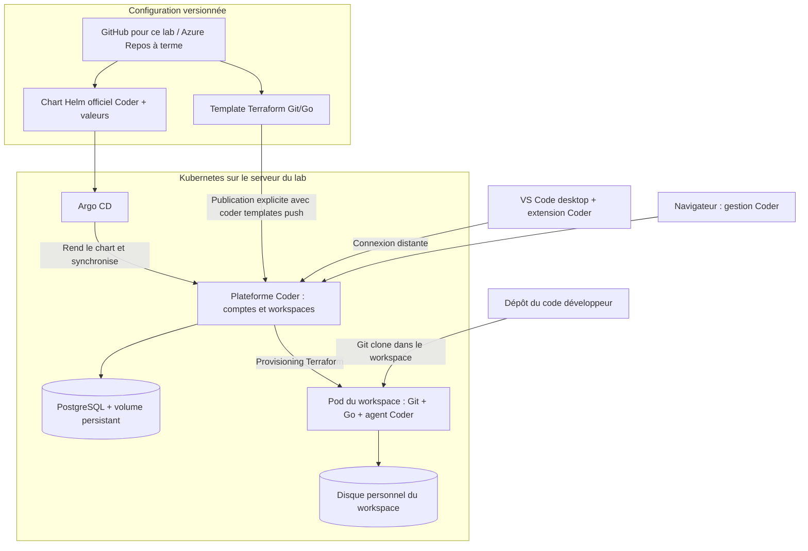

# Lab personnel : Coder, Kubernetes, Helm, Argo CD et Azure DevOps

Objectif : déployer **Coder auto-hébergé** avec un chart Helm piloté par Argo CD, puis créer un workspace Git/Go accessible depuis VS Code desktop.

Ce dépôt présente le prototype testé dans un environnement temporaire OpenAI. Aucun système SUEZ n'a été utilisé. Ce n'est pas une installation de production ni un déploiement entreprise validé.

## Architecture

**Deux opérations distinctes :**

1. Argo CD utilise Helm pour installer et maintenir la **plateforme Coder**.
2. Coder utilise un **template Terraform** pour créer les pods et disques des workspaces.

Connecter un dépôt à Argo CD ne publie pas les templates dans Coder. Cette publication se fait séparément avec la CLI Coder, puis éventuellement une pipeline Azure DevOps.

Azure DevOps Repos hébergera les fichiers Git ; Kubernetes peut être hébergé chez vous ou sur une infrastructure d'entreprise, sans obligation d'utiliser Azure.

## Ce qui a réellement été testé

Le 15 octobre 2026 dans l'instance OpenAI :

- Kubernetes opérationnel ; Argo CD affiche Coder `Synced / Healthy`.
- PostgreSQL répond aux requêtes SQL et utilise un volume persistant.
- Compte Coder local et template Terraform publiés ; workspace créé et agent connecté.
- Connexion SSH via Coder, Git 2.39.5, Go 1.24.2 et exécution d'un programme Go.
- Arrêt/redémarrage via Coder : nouveau pod, même disque et mêmes empreintes des fichiers.
- Permissions Kubernetes positives et négatives vérifiées.

**Non testés :** accès depuis votre navigateur ou VS Code desktop, Azure Repos privé, code-server, recréation sur votre serveur et restauration après perte de machine. Aucune URL publique n'a été créée.

Le lab exécuté utilisait un petit dépôt Git interne contenant le chart. L'Application de ce dépôt pointe maintenant vers **ce GitHub** : c'est une adaptation préparée pour la suite, pas un déploiement déjà vérifié depuis GitHub.

## Lire les fichiers

| Chemin | Rôle |
|---|---|
| [gitops/coder-application.json](gitops/coder-application.json) | Application Argo CD ciblant ce dépôt et la branche main |
| [gitops/coder-values.json](gitops/coder-values.json) | Paramètres Helm Coder, sans secret ni proxy OpenAI |
| [charts/UPSTREAM.md](charts/UPSTREAM.md) | Provenance et version des charts officiels copiés sans modification |
| [kubernetes/postgres.yaml](kubernetes/postgres.yaml) | PostgreSQL de démonstration : StatefulSet, Service et disque de 2 Gio |
| [kubernetes/workspace-rbac.json](kubernetes/workspace-rbac.json) | Permissions de Coder dans le namespace workspaces |
| [templates/git-go/main.tf](templates/git-go/main.tf) | Template de workspace Git/Go avec volume conservé au stop/start |
| [docs/PLAN-LAB.md](docs/PLAN-LAB.md) | Explications, planning sur dix jours et sources officielles |
| [docs/RESULTATS.md](docs/RESULTATS.md) | Tests exécutés et problèmes rencontrés dans OpenAI |

Les fichiers `.json` sont des manifests Kubernetes ou des valeurs Helm valides ; JSON est accepté par ces outils.

## Avant une installation chez vous

Ce dépôt n'installe pas encore automatiquement tout le serveur. Il faut préparer Kubernetes, le stockage dynamique et Argo CD, créer les namespaces `argocd`, `coder` et `workspaces`, puis :

1. Créer hors Git le Secret `postgres-auth` dans `coder`, avec les clés `password` et `url` cohérentes pour PostgreSQL. Le manifeste référence ces clés ; aucune valeur n'est fournie ici.
2. Installer PostgreSQL et les droits du workspace ; PostgreSQL et ces droits ne sont pas encore gérés par l'Application Coder.
3. Autoriser ce dépôt et le namespace `coder` dans le projet Argo CD, puis ajouter l'Application.
4. Publier le template dans Coder avec une identité autorisée.
5. Configurer une URL HTTPS accessible au poste utilisateur **et aux agents**, puis tester VS Code desktop.

L'URL Coder fournie dans les valeurs est **interne au cluster**. Elle convient à la démonstration interne ; elle doit être adaptée pour votre accès utilisateur. Aucun service public ou tunnel n'est créé. Le Secret et les éventuels identifiants Azure Repos doivent rester hors Git.

Un serveur Linux avec 12 Gio de RAM est une base raisonnable pour un workspace simple. CPU, disque, architecture et réseau restent à vérifier. Le template actuel est pour **amd64**, avec 1 CPU / 2 Gio de RAM au maximum et 2 Gio de disque. Un arrêt conserve le disque ; une suppression du workspace le détruit. Ce stockage ne constitue pas une sauvegarde.

## Versions et limites

Base de l'essai : Kubernetes 1.32.2, Argo CD 3.1.9, Helm 3.18.4, Coder 2.26.0, PostgreSQL 16.8, Go 1.24.2. Providers Terraform verrouillés : coder/coder 2.5.0 et hashicorp/kubernetes 2.36.0.

Ces versions fixent le prototype testé, sans prétendre être les dernières ou être validées pour la production. Les charts sont ceux du tag officiel `v2.26.0` ; leur version source est `0.1.0` et l'image Coder est explicitement fixée. Le workspace utilise l'image Go officielle avec UID 1000 ; une future image dédiée pourra créer un véritable utilisateur Linux `coder`.

Le cœur open source de Coder est sous AGPL v3. Les charts upstream et leur licence sont conservés dans `charts/`. Les fonctionnalités Enterprise ont des conditions distinctes. Voir les [licences officielles Coder](https://github.com/coder/coder).
