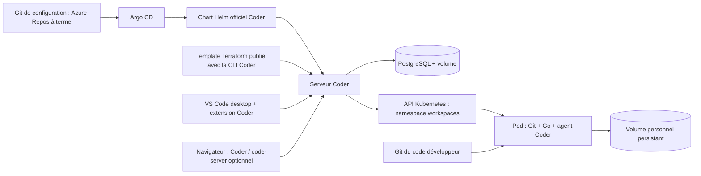

# Lab Coder personnel — état et plan

Diagnostic réalisé le 15 octobre 2026 dans la machine temporaire OpenAI. Aucun accès SUEZ, aucune infrastructure payante créée. Les fichiers de préparation sont hors du dépôt utilisateur, qui était vide (branche locale sans commit et aucune référence distante retournée).

## Architecture

Kubernetes exécute les conteneurs. Un pod est une unité d'exécution ; il peut être supprimé et recréé. Un PVC demande un disque dont la durée de vie est indépendante de celle du pod. Helm regroupe les objets Kubernetes dans un paquet appelé chart. Argo CD compare Git au cluster puis applique la configuration attendue : c'est le fonctionnement GitOps.

Coder gère les utilisateurs, les templates et le cycle de vie des workspaces. Ses templates Terraform décrivent les ressources à créer pour chaque workspace. Installer Coder avec Argo CD et publier un template Coder sont donc deux opérations différentes.

Pour cet essai, un petit dépôt Git HTTP **interne au cluster** contient une copie du chart officiel Coder provenant du tag `v2.26.0`. Il remplace temporairement le gros dépôt upstream dont la récupération dépassait le délai d'Argo CD. Ce dépôt ne contient aucun secret et n'est pas publié sur Internet. Les valeurs sont actuellement portées par l'objet Application ; pour le lab personnel, chart, valeurs et Application devront être versionnés dans le dépôt GitOps. Azure Repos stocke Git ; il n'impose pas d'héberger Kubernetes sur Azure.

## Versions de l'essai

| Composant | Version |
|---|---|
| Kind | 0.27.0 |
| Kubernetes / kubectl | 1.32.2 |
| Argo CD | 3.1.9, manifeste officiel |
| Helm | 3.18.4, binaire inclus dans l'image officielle Argo CD |
| Coder + source du chart | 2.26.0 |
| PostgreSQL | 16.8-bookworm, image officielle |
| Redis | 7.2.11-alpine, image officielle Docker Hub |
| Image workspace / Go | golang:1.24.2-bookworm |
| Terraform utilisé par Coder | 1.13.0 observé dans les logs |
| Providers Terraform | coder/coder 2.5.0 ; hashicorp/kubernetes 2.36.0 |

Ces versions constituent une base d'essai fixée, pas une affirmation qu'elles sont les dernières ou une sélection homologuée pour la production. Avant un déploiement durable, examiner support, compatibilité et correctifs de sécurité. `versions-observed.json` relève les images effectivement exécutées et leurs identifiants. Le fichier `.terraform.lock.hcl` est conservé avec le template ; les signatures des providers sont vérifiées pendant l’installation.

## Ressources et choix pour votre installation

Pour un poste ou une VM personnelle, prévoir environ **4 vCPU, 8 Gio de RAM et 40–60 Gio de disque pour un workspace**, ou **6–8 vCPU, 12–16 Gio et 60–100 Gio pour deux**. Ce sont des budgets de départ, pas des mesures de charge ni des minima garantis. Réserver environ 1–2 Gio de RAM par workspace Go simple ; les compilations importantes peuvent demander davantage.

Un cluster à un nœud suffit pour apprendre : Kind sur un ordinateur avec Docker, ou une petite VM Linux avec une distribution Kubernetes adaptée. PostgreSQL peut rester dans le cluster pour ce prototype, avec volume et sauvegarde. Le stockage local conserve les fichiers au redémarrage d'un pod ; il ne protège pas d'une perte de machine ou d'une suppression du cluster. Les volumes de l'essai font 2 Gio pour PostgreSQL et 2 Gio pour le workspace ; ils seront à agrandir dans votre lab.

Authentification de l'essai : compte Coder local, mot de passe aléatoire, identifiants conservés hors Git. Pas d'exposition publique. Service Coder de type ClusterIP et accès interne HTTP uniquement ; cela n'est pas une configuration d'exposition Internet. Sur votre lab, prévoir DNS, certificat HTTPS et un accès privé/VPN ou un accès entrant maîtrisé. Les agents doivent joindre l'URL Coder et votre poste doit pouvoir joindre cette même plateforme. Prévoir WebSocket et relais Coder ; aucun port SSH public par workspace n'est nécessaire au parcours Coder.

Le compte de service Coder gère les pods/PVC dans `workspaces`, sans droit de création dans `kube-system`. Les pods développeurs n'ont pas le jeton Kubernetes monté automatiquement et fonctionnent avec UID/GID 1000. Aucun socket Docker de l'hôte n'est monté dans les workspaces. Les droits Terraform sont puissants dans leur namespace : seuls des administrateurs de confiance doivent publier les templates. Le plugin réseau Kind utilisé ici ne garantit pas l'application des NetworkPolicies ; une politique déclarée ne vaut donc pas preuve d'isolation réseau.

Le cœur du parcours testé ne nécessite pas de licence payante. La documentation Coder consultée identifie SCIM comme Premium ; vérifier l'édition et les tarifs avant d'ajouter des exigences d'entreprise. `code-server` est distinct de Coder et sert l'éditeur dans le navigateur ; son catalogue d'extensions diffère de celui de VS Code desktop. Il n'est pas installé dans cet essai.

## GitOps, templates et secrets

Le dépôt **configuration** contiendra les Applications Argo CD, les valeurs Helm, les droits Kubernetes et les templates Terraform. Le dépôt **code développeur** contiendra les programmes Go ; il sera cloné dans le disque du workspace. Ce sont deux responsabilités, même s'il est possible de commencer avec un seul dépôt pour apprendre.

Pour publier un template : une personne ou une pipeline validée exécute `coder templates push` après vérification des changements. Nous l'avons fait explicitement dans cet essai. Argo CD seul ne pousse pas les templates dans Coder. À terme, utiliser une pipeline Azure DevOps avec identité dédiée, droits minimaux et validation avant activation d'une nouvelle version.

Aucun mot de passe, PAT, jeton Coder ou état Terraform sensible dans Git. Les secrets PostgreSQL sont des Secrets Kubernetes créés à l'exécution. Base de données et états de provisioning exigent des sauvegardes et des restrictions d'accès. Les identifiants de lecture Azure Repos d'Argo CD seront fournis hors Git ; aucun accès Azure DevOps privé n'a été testé ici. Microsoft recommande les jetons Entra pour Git ; choisir un mécanisme réellement compatible avec la version Argo CD et la politique de l'entreprise, avec rotation et droits de lecture seulement.

En entreprise : remplacer le stockage local par un stockage durable approuvé, ajouter sauvegarde/restauration vérifiée de PostgreSQL et des volumes, identité d'entreprise, gestionnaire de secrets, quotas, isolation réseau vérifiée, supervision, politique d'images et validation des templates. L'architecture réseau et les droits doivent être revus avec les équipes concernées. Aucune connexion aux systèmes SUEZ n'est nécessaire pour ce lab personnel.

## Accès navigateur et VS Code desktop

Le service est actuellement accessible uniquement depuis la machine OpenAI. Le transfert de port local sert aux tests internes ; ce n'est pas une URL utilisable depuis votre poste. Aucun mécanisme de publication entrante pris en charge n'a été fourni dans cette session. Aucun tunnel public n'a été créé. Un test VS Code desktop sur votre ordinateur n'a donc pas été exécuté.

Sur votre propre machine, le parcours recommandé sera : URL HTTPS Coder joignable depuis le navigateur **et les agents**, connexion au compte, puis bouton « VS Code Desktop » ou extension `coder.coder-remote`. Vérifier l'ouverture du workspace, le terminal, l'exécution Go et la reconnexion après arrêt/redémarrage. Un tunnel éventuel exige une URL stable, HTTPS/WebSocket, le bon `CODER_ACCESS_URL` et un contrôle d'accès ; une simple URL d'aperçu Web ne prouve pas la compatibilité VS Code. Pour code-server, ajouter une application au template et tester son routage et son authentification via Coder séparément.

## Dix jours de travail

| Jour | Travail | Critère de réussite |
|---|---|---|
| 1 | Comprendre le schéma, choisir la machine et inventorier les accès | CPU/RAM/disque/OS et réseau connus |
| 2 | Installer les outils à versions fixées et Kubernetes | Nœud Ready, DNS et PVC testés |
| 3 | Installer Argo CD et connecter le dépôt de configuration | Application de démonstration Synced/Healthy |
| 4 | PostgreSQL, Secret hors Git, chart Coder | Connexion Coder et requête SQL réussies |
| 5 | Déploiement Coder piloté par Argo CD | Coder Synced/Healthy ; dérive corrigée |
| 6 | Template minimal Git/Go/PVC, publication explicite | Workspace créé et agent connecté |
| 7 | URL HTTPS et extension Coder sur votre poste | Session VS Code desktop réellement ouverte |
| 8 | Programme Go et test de persistance | Même fichier après stop/start, nouveau pod et même PVC |
| 9 | Sauvegarde/restauration, quotas et droits négatifs | Restauration testée ; actions interdites refusées |
| 10 | Rejouer depuis une machine propre et documenter | Guide suivi sans secret dans Git ; limites listées |

Code-server vient seulement après le parcours desktop et la persistance. Si une journée est bloquée par DNS ou l'accès réseau, garder le parcours interne fonctionnel et reporter explicitement le test externe.

Questions nécessaires pour votre futur lab : ordinateur ou serveur disponible, OS/architecture, CPU/RAM/disque utilisables ; accès depuis le même réseau ou à distance ; domaine et possibilité d'accès HTTPS/VPN ; un ou deux utilisateurs simultanés. Elles ne bloquent pas l'essai OpenAI.

## Sources officielles consultées

Les sites documentaires directs ont renvoyé un refus du proxy. Les sources officielles GitHub accessibles ont été consultées à la place ; les pages sous `main` décrivent un état courant et les pages sous tag décrivent précisément la version d'essai.

- [Coder : installation Kubernetes, version 2.26.0](https://github.com/coder/coder/blob/v2.26.0/docs/install/kubernetes.md)
- [Chart Coder et valeurs, version 2.26.0](https://github.com/coder/coder/tree/v2.26.0/helm/coder)
- [Template Kubernetes officiel servant de référence](https://github.com/coder/coder/blob/v2.26.0/examples/templates/kubernetes/main.tf)
- [Coder : accès VS Code desktop et code-server](https://github.com/coder/coder/blob/main/docs/user-guides/workspace-access/vscode.md)
- [Coder : OIDC et mention de SCIM Premium](https://github.com/coder/coder/blob/v2.26.0/docs/admin/users/oidc-auth/index.md)
- [code-server : FAQ, accès et différences d'extensions](https://github.com/coder/code-server/blob/main/docs/FAQ.md)
- [Helm : documentation officielle du projet](https://github.com/helm/helm/blob/main/README.md)
- [Argo CD : Helm sert au rendu des manifests, Argo gère leur cycle de vie](https://github.com/argoproj/argo-cd/blob/master/docs/user-guide/helm.md)
- [Argo CD : dépôts privés et modes d'authentification Azure](https://github.com/argoproj/argo-cd/blob/master/docs/user-guide/private-repositories.md)
- [Azure Repos : clonage et recommandation d'authentification Entra](https://github.com/MicrosoftDocs/azure-devops-docs/blob/main/docs/repos/git/clone.md)
- [Kind : fonctionnement et prérequis](https://github.com/kubernetes-sigs/kind/blob/main/site/content/docs/user/quick-start.md)
